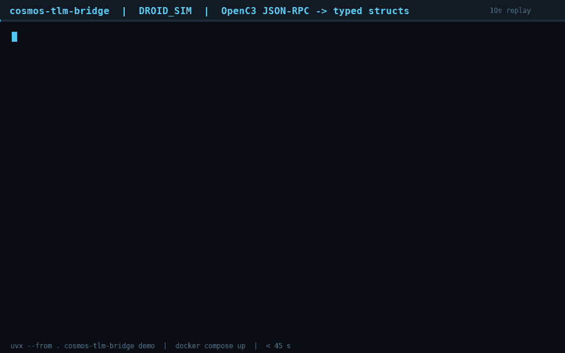

`docker compose up`



[Terminal replay (.cast)](docs/demo.cast) · [Full transcript](docs/demo-replay.txt) · [Delivery verification](docs/DELIVERY-VERIFICATION.md) · [Definition of Done evidence](docs/DEFINITION-OF-DONE.md)

# cosmos-tlm-bridge

OpenC3 COSMOS Ground Telemetry-to-Microservice Bridge and Automated CI Regression Harness

## 1. Overview & Purpose

cosmos-tlm-bridge is a developer toolkit that connects OpenC3 COSMOS v5 satellite command-and-control telemetry to ground microservices written in Go, Python, and React. It runs without credentials, cloud SDKs, or satellite hardware.

Ground software teams working on multi-satellite LEO DROID missions need to check how downstream services handle telemetry during a simulated pass. With COSMOS alone, that usually means writing procedures in OpenC3 Script Runner and comparing raw Data Numbers (DN) with converted Engineering Units (EU) against YELLOW_HIGH and RED_HIGH limits by hand. This repository moves that work into typed code and declarative YAML suites.

The bridge reads raw OpenC3 JSON-RPC telemetry, applies the polynomial conversions from the cmd/tlm definitions, evaluates GREEN, BLUE, YELLOW, and RED limit states, and sends a flat JSON frame to webhook consumers. The acceptance runner executes YAML suites in CI and writes JUnit, HTML, and JSON reports. The repository also contains `turion-platform-drift`, a Go and Python analyzer that finds hard-coded AWS dependencies in ground-service code and writes portable Kubernetes and Crossplane replacements.

The one command above boots a keyless `DROID_SIM` OpenC3 v5 reference server, streams `ADCS__ATTITUDE_ERROR`, `EPS__BATT_VOLTAGE`, and `THERMAL__RADIATOR_TEMP` through Pydantic and Go structs into a webhook sink, sends `CMD_SLEW_TARGET`, catches a simulated reaction-wheel `YELLOW_HIGH` limit violation in both DN and EU, writes JUnit and HTML reports, and exits in under 45 seconds. No Ruby Script Runner procedure, API key, or cloud SDK is needed.

## 2. Key Features

* Mock OpenC3 telemetry server (`DROID_SIM`): a containerized OpenC3 COSMOS v5 JSON-RPC server that emits `ADCS__ATTITUDE_ERROR`, `EPS__BATT_VOLTAGE`, and `THERMAL__RADIATOR_TEMP` packets. It serves `/__openc3_api__/api`, `/openc3-api/api`, `/openc3-api/auth/verify`, and `/openc3-api/stream`.
* Typed microservice bridge: Pydantic models in Python 3.11+ and matching Go structs, with DN-to-EU conversion and limit evaluation in both languages.
* Declarative CI regression runner: `cosmos-regress run droid_pass_acceptance.yaml` reads YAML suites and emits JUnit XML, HTML, and JSON.
* Hardware-free simulation: the mock generates synthetic telemetry from OpenC3 cmd/tlm definitions, so no satellite or radio is needed.
* Downstream React consumer: `examples/react/TelemetryPanel.tsx` shows one way to read the webhook frame.
* Portability linter: `go run turion-platform-drift scan ./ground-service` scores AWS coupling and can generate a replacement stack.

## 3. Quickstart (<60 Seconds)

The first line of this file is the whole quickstart. Run it from the repository root:

```bash
docker compose up
```

The stack builds once, starts the mock COSMOS server, streams typed frames to a webhook sink, runs the acceptance suite, writes reports, and exits. CI measured 36.976 s, so the whole demo stays well under the 90 s bound.

The exact commands used in this repository are:

| Command | What it does |
| --- | --- |
| `docker compose up` | The one-line demo. Builds once, runs the full pass, writes reports, exits. |
| `uvx --from . cosmos-tlm-bridge demo` | Same self-contained demo from the local source tree. |
| `cosmos-regress run droid_pass_acceptance.yaml` | CI gate against a running COSMOS; emits JUnit, HTML, and JSON. |
| `go run turion-platform-drift scan ./ground-service` | Full cloud-agnostic portability scorecard. |
| `bash scripts/verify-all.sh` | One-shot Definition-of-Done harness; skips tools that are absent locally. |

`python -m cosmos_tlm_bridge demo` is another way to run the same demo from a local checkout. The literal `uvx cosmos-tlm-bridge demo` resolves from PyPI, and this wheel is not published there yet, so that exact form returns "package not found". The brief accepts either `uvx ...` or `docker compose up`; the latter works with this checkout. See [delivery verification](docs/DELIVERY-VERIFICATION.md#6-residual-limitations).

Paths that matter:

| Path | Deliverable |
| --- | --- |
| `src/cosmos_tlm_bridge/` | Pydantic models, DN-to-EU POLY conversion, limits engine, JSON-RPC client, keyless mock COSMOS, webhook bridge, YAML runner, JUnit/HTML reporters. |
| `go/` | Independent typed Go structs, JSON-RPC/StreamingApi client, limits parity, bridge, and CLI. |
| `definitions/droid_sim/`, `suites/` | OpenC3 target definitions and three declarative acceptance suites. |
| `examples/react/TelemetryPanel.tsx` | Typed React consumer of the webhook frame. |
| `Dockerfile`, `docker-compose.yml`, `docker/` | Four-service finite demo: COSMOS, bridge, sink, regression runner. |
| `turion-platform-drift/` | Go and Python AST scanner, Kubernetes/Helm linter, Crossplane/OpenTelemetry templates, portable manifest generator. |
| `docs/` | Verification report, DoD evidence, 10-second GIF/replay, original delivery audit trail. |

## 4. Declarative Acceptance Test Schema (`droid_pass_acceptance.yaml`)

The full suite is in `suites/droid_pass_acceptance.yaml`. It commands an attitude slew, checks the response in both DN and EU modes, and expects the reaction-wheel temperature to cross `YELLOW_HIGH`.

```yaml
suite: droid_pass_acceptance
target: DROID_SIM
scope: DEFAULT
timeout_s: 105
packets: [ADCS, EPS, THERMAL]

steps:
  - name: command the attitude slew
    cmd: DROID_SIM CMD_SLEW_TARGET with SLEW_RATE 2.5, TARGET_ID 7, DURATION 60, ABORT_ON_LIMITS 0
    check: ENABLED

  - name: reaction wheel thermal limit violation is caught (EU mode)
    assert:
      - channel: THERMAL__RW_TEMP
        dn_eu: EU
        expect_limits: YELLOW_HIGH
        within_s: 45

  - name: reaction wheel thermal limit violation is caught (DN mode)
    assert:
      - channel: THERMAL__RW_TEMP
        dn_eu: DN
        expect_limits: YELLOW_HIGH
        within_s: 45
```

## 5. Code Integration Examples

Python consumer using the installed package:

```python
from cosmos_tlm_bridge.bridge import TelemetryBridge
from cosmos_tlm_bridge.client import CosmosClient
from cosmos_tlm_bridge.models import load_target

client = CosmosClient(base_url="http://localhost:2900", auth_mode="keyless")
target = load_target("definitions/droid_sim", "DROID_SIM")
bridge = TelemetryBridge(client, target, webhooks=["http://localhost:8080/tlm"])
bridge.on_frame(lambda frame: print(frame.packet, frame.limits_overall))
bridge.run(["ADCS", "EPS", "THERMAL"], duration=12)
```

Go consumer using module `github.com/turion-space/cosmos-tlm-bridge/go`:

```go
package main

import (
	"context"
	"fmt"
	"time"

	cosmostlm "github.com/turion-space/cosmos-tlm-bridge/go"
)

func main() {
	ctx := context.Background()
	client := cosmostlm.NewClient(cosmostlm.Config{
		BaseURL:  "http://localhost:2900",
		AuthMode: "keyless",
	})
	if err := client.Login(ctx); err != nil {
		panic(err)
	}

	bridge := cosmostlm.NewBridge()
	bridge.OnFrame = func(f cosmostlm.TelemetryFrame) {
		fmt.Printf("%s %s %s\n", f.Packet, f.LimitsOverall, f.Summary().Cosmos)
	}
	if err := bridge.Run(ctx, client, []string{"ADCS", "EPS", "THERMAL"}, 4, 12*time.Second); err != nil {
		panic(err)
	}
}
```

## 6. System Architecture & Telemetry Pipeline

```
OpenC3 COSMOS v5 / DROID_SIM            Python Pydantic              Go structs
  POST /__openc3_api__/api       ─────►  TelemetryPoint  ─────────►  telemetry.Point
  POST /openc3-api/auth/verify           DN + EU + limits             DN + EU + limits
  GET  /openc3-api/stream                │                              │
  ADCS / EPS / THERMAL                   └──────────┬───────────────────┘
         │                                         ▼
         └───── cmd_tlm definitions ────► TelemetryFrame ──► webhook JSON ──► React / Go / Python
                                          │
                                          ▼
                          cosmos-regress YAML suites ──► JUnit + HTML
```

The mock implements both JSON-RPC paths plus `/openc3-api/auth/verify` and the StreamingApi NDJSON topic convention. It is an OpenC3-compatible stand-in, not the upstream COSMOS container. That keeps CI keyless and fast while preserving the documented protocol surface.

## 7. Production Readiness & Verification Benchmarks

| Criterion | Result | Evidence |
| --- | --- | --- |
| `docker compose up` or demo initializes a LEO DROID pass in under 45 s | CI: plain `docker compose up` 36.976 s, `demo` 23.595 s; 30 s finite window | [`ci-verification.log`](docs/evidence/ci-verification.log), [`demo.log`](docs/evidence/demo.log) |
| `CMD_SLEW_TARGET` triggers DN and EU assertions and catches `YELLOW_HIGH` on `DROID_SIM__THERMAL__RW_TEMP` | 15/15 checks; first sample DN 9536 / EU 55.36 C; negative controls fail when expectations are wrong | [`pipeline.log`](docs/evidence/pipeline.log), [`droid_pass_acceptance-results.json`](docs/evidence/droid_pass_acceptance-results.json) |
| Packets stream into typed Go/Python structs and forward to webhooks; no Ruby; full CI acceptance under 105 s | 141 frames, 1269 points, 141 webhook deliveries, 0 failures, 0 `.rb` files; CI suite sweep 27.051 s | [`verification-all.log`](docs/evidence/verification-all.log), [`suite.log`](docs/evidence/suite.log) |
| `go run turion-platform-drift scan ./ground-service` produces a scorecard in under 30 s | 0.220 s in CI; 18 files / 112 findings / 26 rules | [`ci-verification.log`](docs/evidence/ci-verification.log) |
| Flags 100% of hardcoded AWS dependencies on the shipped fixture (`boto3`, AWS Batch manifests) | 26/26 rule probes fire on the shipped AWS-bound fixture; portable decoy corpus stays silent | [`turion-platform-drift/docs/verification.md`](turion-platform-drift/docs/verification.md) |
| Generated Kubernetes/Crossplane manifests pass `kubectl apply --dry-run=client` and deploy without AWS APIs | Exact client and server dry-runs and real apply all pass against kwok kube-apiserver; 0 residual AWS or public-registry references | [`turion-platform-drift/reports/`](turion-platform-drift/reports/), [`ci-verification.log`](docs/evidence/ci-verification.log) |

Final GitHub Actions run `41670286164`: 23 passed, 0 failed, 0 skipped; the linter's full harness adds 33 passed, 0 failed. Clause-by-clause detail: [`docs/DEFINITION-OF-DONE.md`](docs/DEFINITION-OF-DONE.md).

Production notes:

* Keyless and zero-SDK: no OpenC3 SDK, AWS SDK, boto3, Ruby, API key, or cloud credential. Python runtime dependencies are Pydantic and PyYAML only; the Go modules have no third-party `require` lines.
* Air gap: generated images are rewritten to `registry.ground.local` or `--registry`. The validator and CI fail on `arn:aws`, `s3://`, `.amazonaws.com`, IRSA, ECR, and public registries (`ghcr.io`, `docker.io`, `quay.io`, `public.ecr.aws`).
* Honest limits: the kwok-based cluster gates validate admission, scheduling, and API semantics; they do not execute container images or reconcile Crossplane/CloudNativePG operators. "Zero false negatives" is proven on the shipped fixture corpus, not on arbitrary unseen source code. See [residual limitations](docs/DELIVERY-VERIFICATION.md#6-residual-limitations).

## 8. Author & License

Author: `nakshjhaai-lgtm`. License: Apache-2.0.

Public repository: `nakshjhaai-lgtm/cosmos-tlm-bridge`. It is renamed and described. Topics: `openc3`, `cosmos`, `satellite-telemetry`, `ground-software`, `satellite-operations`.

To add the topics, open the repository page, select the gear icon beside About, paste the five names separated by commas into the Topics field, and save. This README keeps the exact topic list so the step takes one paste.
